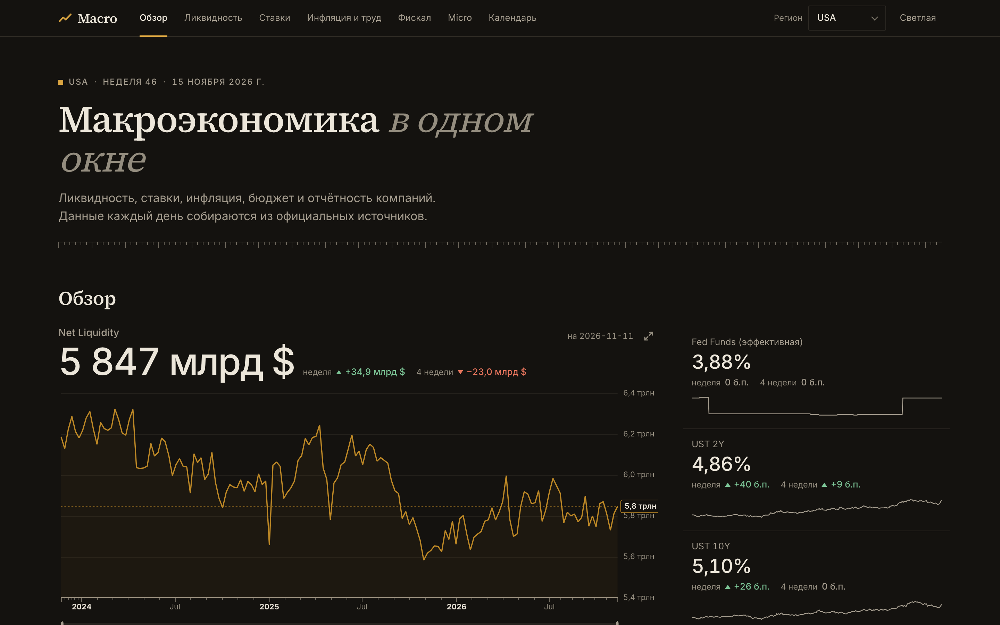
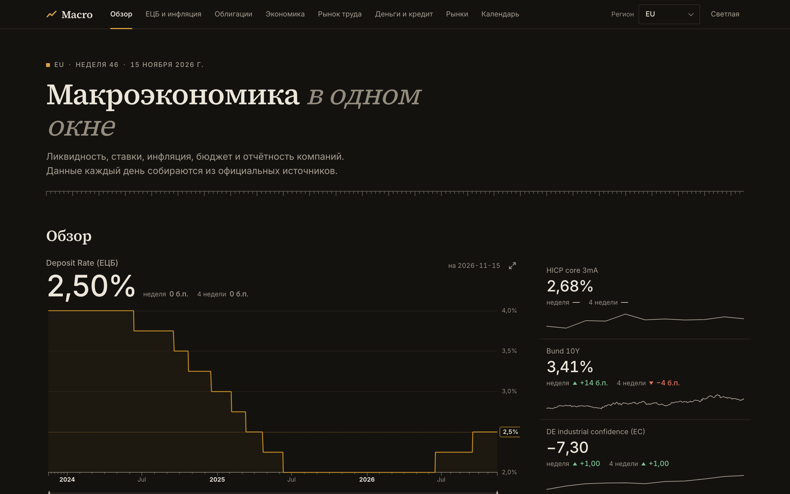
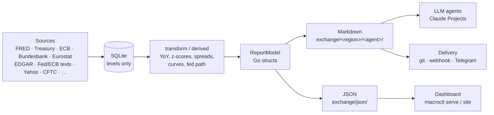

# macro-collector

**English** · [Русский](README.ru.md)

A self-hosted Go daemon that collects macro and market data for the US and Europe (FRED, US Treasury, ECB, Bundesbank, Eurostat, SEC EDGAR, Fed and ECB texts, and more), stores it in SQLite, computes the derived metrics and once a week exports compact Markdown briefings for LLM agents (Claude Projects or any other). A read-only dashboard shows the same data as charts.

**Live demo (open data only):** https://skwizi4.github.io/macro-site/




- One static binary pair, no cgo: `macrod` (daemon) and `macroctl` (CLI, dashboard, exports).
- Runs on a laptop or a small ARM VM with `docker compose up -d`.
- Regions, agents and their files are configuration, not code: presets for US equities, European equities and rates only.
- The dashboard, the exported briefings and the agent prompts are in Russian (code, comments and these docs are in English); templates and prompts are plain files you can translate.
- **The code is open (MIT), the data is not.** You connect your own keys; nothing downloaded is redistributed. See [docs/data-sources.md](docs/data-sources.md).

## Quick start (Docker, ~15 minutes)

You need Docker with Compose and a free [FRED API key](https://fred.stlouisfed.org/docs/api/api_key.html). Nothing else is required for the first run.

```bash
git clone https://github.com/skwizi4/macrod.git
cd macrod
cp presets/us-equities.yaml config.yaml
cp .env.example .env
mkdir -p data secrets   # on Linux also: sudo chown 10001:10001 data
```

1. In `.env` set `FRED_API_KEY=<your key>` and a dashboard password `MACRO_DASHBOARD_PASSWORD=<anything>`.
2. In `config.yaml` set `edgar.user_agent` to `"macro-collector <your e-mail>"` — the SEC rejects requests without a contact.
3. Start the daemon and check the setup:

   ```bash
   docker compose up -d
   docker compose exec macrod macroctl --config /app/config.yaml doctor
   ```

   Every line should be ✅ (config, keys, one request per source, database write, disk space).
4. Load history and build the first export (about two minutes; a shorter `--since` is faster):

   ```bash
   docker compose exec macrod macroctl --config /app/config.yaml backfill --source fred --since 2015-01-01
   docker compose exec macrod macroctl --config /app/config.yaml export --region all
   ```
5. Start the dashboard and open http://127.0.0.1:8080 (user `macro`, your password):

   ```bash
   docker compose --profile dashboard up -d
   ```
6. Optional: fill every other source now instead of waiting for the daemon's schedule (Treasury, Yahoo, CFTC, Fed texts, EDGAR — about 10–12 minutes), then export again:

   ```bash
   docker compose exec macrod macroctl --config /app/config.yaml fetch --source all
   docker compose exec macrod macroctl --config /app/config.yaml export --region all
   ```

From now on the daemon polls each source on its own schedule and writes the weekly export on Sunday 16:00 (config `timezone`) into `data/exchange/`.

**Without Docker:** Go (version in `go.mod`), then `make build`, `./bin/macroctl --config config.yaml doctor`, `make backfill`, `./bin/macroctl --config config.yaml export --region all` and `make serve` (http://127.0.0.1:8080, no password on loopback). Release archives for macOS, Linux and Windows are on the [Releases](https://github.com/skwizi4/macrod/releases) page; the image is `ghcr.io/skwizi4/macrod`.

## How it works



- **Collect.** Each source has its own client (`internal/sources/*`) with retries and pacing; the scheduler polls on release calendars (FRED, ECB, Eurostat, Treasury), so data arrives minutes after publication. All writes go through a single SQLite writer goroutine.
- **Transform.** Only levels are stored; every transformation (YoY, annualised rates, z-scores, spreads, curve shape, fed funds path from futures) is computed in `internal/transform` and `internal/derived`.
- **Export.** Once a week, and right after an FOMC or ECB decision, one Go `ReportModel` per file is rendered twice: Markdown for the agents and JSON for machines and the dashboard ([docs/schema](docs/schema)). Agent instructions live in [`prompts/`](prompts) and are copied next to the files as `instructions.md`.
- **Deliver.** The export folder is the result; optionally the daemon commits it to your private git repository, posts a signed webhook and sends a Telegram message.
- **Look.** `macroctl serve` is a read-only dashboard (vanilla JS + ECharts, embedded in the binary); `macroctl site --demo` builds a static site with open data only.

## Presets

| Preset | Region(s) | What you get |
|---|---|---|
| `us-equities` (= `config.example.yaml`) | USA | Monetary, Fiscal & Liquidity, Micro (8 large caps from EDGAR), News, Master (markets, calendar, key metrics, sentiment) |
| `eu-equities` | Europe | Monetary & Macro (ECB, Eurostat), Fiscal & Bonds (Bund curve, auctions, spreads), Micro (8 issuers), News, Master |
| `rates-only` | USA | FRED rates and the release calendar only — the smallest setup |

`macroctl init --preset <name>` writes the preset to `config.yaml` (`--force` to overwrite). Both regions fit in one config: add the `eu` region and the European sections from `presets/eu-equities.yaml`.

Optional features are off in the presets and need their own keys: Telegram channels + Gemini classification (`GEMINI_API_KEY`), git delivery (`GIT_SSH_KEY_PATH`), Telegram bot notifications (`TG_BOT_TOKEN`, `TG_CHAT_ID`), webhook (`WEBHOOK_URL`), the public demo site (`SITE_SSH_KEY_PATH`). `macroctl doctor` lists what an enabled feature is missing.

## Output

```
data/exchange/
  usa/monetary/current_week.md       usa/master/markets_usa.md
  usa/fiscal_liquidity/…             usa/master/calendar_usa.md
  usa/micro/…                        usa/news/current_week.md
  eu/…                               json/…   (same files as JSON)
  archive/<iso_week>/…
```

Each file starts with a YAML header (region, agent, ISO week, period, sources ok/failed, stale series) followed by tables with fixed units and short methodology notes. What every metric means and why an agent needs it: [DATA_MAP.md](DATA_MAP.md) (in Russian). Examples of the format: [examples/](examples).

## CLI

```
macroctl doctor                       check config, keys, sources, database, disk
macroctl backfill --source fred       load history (also treasury, yahoo, cftc, ecb, eurostat, …)
macroctl fetch --source all           incremental update of every enabled source
macroctl status                       freshness of sources and series
macroctl calendar --days 14           upcoming releases
macroctl export --region all          weekly export now (--week 2026-W45, --dry-run)
macroctl serve                        dashboard on 127.0.0.1:8080
macroctl site --out site --demo       static demo site (open data only)
macroctl forecast import|score        log of the agents' forecasts and their scorecard
```

`macroctl` without arguments prints every command. The full reference (in Russian) is in [README.ru.md](README.ru.md).

## FAQ

**Which keys do I really need?** Only `FRED_API_KEY` and an e-mail in `edgar.user_agent`. Treasury, ECB, Bundesbank, Eurostat, CFTC and EDGAR need no key. Everything else is optional; see [docs/data-sources.md](docs/data-sources.md) for keys, limits and terms of every source.

**Why is there no data in the repository?** Many providers do not allow redistribution (Yahoo, ICE, S&P, UMich, Cboe, Telegram content). Everyone downloads under their own key and terms. The demo site shows only data whose licence allows it (public-domain FRED series, Treasury, EDGAR facts, ECB, the Bundesbank's own series, Eurostat).

**Yahoo and Telegram?** Both are optional and unofficial for this use: Yahoo has no documented API and its terms prohibit automated collection and redistribution; Telegram channels are read through the public web preview and their posts belong to the authors. Enable them only for personal use — details in [docs/data-sources.md](docs/data-sources.md).

**Does it work on Windows?** The binaries build for Windows (release archives); Docker Desktop is the tested path. On macOS with Docker, don't open `data/macro.db` from the host while the container runs.

**How do I run it on a server?** The same `docker compose up -d` on any Linux host (tested on an Oracle Cloud Always Free ARM VM). Keep the dashboard on 127.0.0.1 and reach it through an SSH tunnel: `ssh -L 8080:127.0.0.1:8080 user@server`. Step-by-step notes are in [README.ru.md](README.ru.md#деплой-на-сервер-oracle-cloud-always-free-arm-ubuntu).

**Can I add a region, agent or series?** Yes, in `config.yaml` without touching Go code: `regions:` defines folders, agents and the tables of each file; templates can be overridden with `templates_dir`. A new source is code — see [CONTRIBUTING.md](CONTRIBUTING.md).

## Contributing and license

See [CONTRIBUTING.md](CONTRIBUTING.md). Tests never touch the network (`make check`). Licensed under the [MIT License](LICENSE). Data belongs to its providers.
